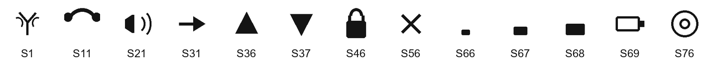

# ST7032i 仕様メモ

Sitronix ST7032 V1.4（2008/08/18）のうち、I2C 版である ST7032i をファームウェアから使うときに参照する項目だけをまとめた。命令の並びは ST7066U に近い。ガラス上のアイコン絵柄と、どのセグメントが実装されているかはモジュール側の仕様である。

## 概要

- ロジック電源は 2.7〜5.5 V。LCD ドライバ電源は 3.0〜7.0 V。
- 表示 RAM は 80 文字（80×8 bit）。5×8 ドット。CGROM は最大 256 文字。CGRAM は最大 64×8 bit。
- ドライバは 16 common × 80 segment に加え、アイコン用の 1 common × 80 segment を持つ。
- ICON RAM は 16×5 bit で、アイコンは S1〜S80 の 80 ドット。
- I2C は Fast-mode（400 kbit/s）まで。書き込み専用で、表示データと命令は読めない。

## I2C

SDA と SCL はプルアップする。バスが空いているときだけ転送を始める。

7 bit アドレスは `0111110`（`0x3E`）固定で、ほかのアドレスにはできない。R/W は常に 0（Write）。8 bit で送るアドレスバイトは `0x7C`。

1 転送は次の並びである。

```text
START、アドレス、制御バイト、データバイト、…、STOP
```

制御バイトの上位 2 bit だけが意味を持つ。下位 6 bit は 0。

| bit | 名前 | 内容 |
| --- | --- | --- |
| 7 | Co | 0 ならこの制御バイトが最後で、続くのはデータバイトだけ。1 ならデータバイトのあとにもう一度制御バイトが来る |
| 6 | RS | 0 なら命令。1 なら DDRAM / CGRAM / ICON RAM へのデータ |

したがって、命令 1 個を単独で送る制御バイトは `0x00`、表示データ 1 個を単独で送る制御バイトは `0x40` である。各バイトの ACK はスレーブが出す。この ACK は Busy フラグではない。

I2C では Busy フラグを読めない。次の命令は、下表の実行時間が過ぎてから送る。Clear Display と Return Home、およびフォロワ投入後の電源安定待ちは、通常命令より長い。

命令実行時間は内部発振周波数による。データシートの初期化例は 380 kHz の時間で書かれている。機能一覧にある内蔵発振の公称は 540 kHz。

| 命令 | 380 kHz | 540 kHz | 700 kHz |
| --- | --- | --- | --- |
| Clear Display、Return Home | 1.08 ms | 0.76 ms | 0.59 ms |
| 上記以外 | 26.3 μs | 18.5 μs | 14.3 μs |

## 電源投入時の内部リセット

VDD が安定してから 40 ms の間、内部は Busy のまま次の状態になる。電気的条件を外れると内部リセットは動かない。そのときは XRESET でリセットする。

- DDRAM をクリアする。
- Function Set は DL=1、N=0（1 行）、DH=0、IS=0。
- 表示、カーソル、ブリンクはオフ。
- Entry Mode はアドレスを +1 し、表示シフトはしない。
- 内部発振の F2 F1 F0 は `100`。
- アイコンはオフ（Ion=0）。バイアスは 1/5（BS=0）。ブースタとフォロワはオフ。
- コントラスト C5〜C0 は `100000`。フォロワ増幅 Rab2〜Rab0 は `010`（1.5 倍）。

## 命令

Function Set の IS で命令表を選ぶ。IS=0 が通常、IS=1 が拡張。Clear、Return Home、Entry Mode、Display ON/OFF、Function Set、Set DDRAM、RAM への書き込みは両方の表にある。Set CGRAM とカーソル／表示シフトは IS=0 だけ、アイコンとコントラストは IS=1 だけである。

Function Set のビットは `001 DL N DH 0 IS`。

| ビット | 内容 |
| --- | --- |
| DL | 1 で 8 bit。I2C では 1 にする |
| N | 1 で 2 行、0 で 1 行 |
| DH | 1 で倍角。N=1 かつ DH=1 は禁止 |
| IS | 1 で拡張命令 |

2 行・通常フォントで通常命令にするコードは `0x38`、同じ設定で拡張命令にするコードは `0x39`。

### 通常命令（IS=0）

| 命令 | コード | 内容 |
| --- | --- | --- |
| Clear Display | `0000 0001` | DDRAM 全体へ `0x20` を書き、アドレスを `0x00` に戻す。I/D は 1 になる |
| Return Home | `0000 001x` | アドレスを `0x00` に戻す。DDRAM の中身は残る |
| Entry Mode | `0000 01 I/D S` | I/D=1 で右へ進む。S=1 かつ DDRAM 書き込みのとき表示全体をシフトする |
| Display ON/OFF | `0000 1 D C B` | D が表示、C がカーソル、B がブリンク |
| Cursor / Display Shift | `0001 S/C R/L xx` | S/C=0 でカーソル、1 で表示。R/L=1 で右 |
| Set CGRAM | `01 AC5〜AC0` | 外字 RAM のアドレス |
| Set DDRAM | `1 AC6〜AC0` | 表示 RAM のアドレス |

### 拡張命令（IS=1）

| 命令 | コード | 内容 |
| --- | --- | --- |
| Bias / OSC | `0001 BS F2 F1 F0` | BS=0 で 1/5、1 で 1/4。F2〜F0 はフレーム周波数 |
| Set ICON address | `0100 AC3〜AC0` | アイコンアドレス `0x00`〜`0x0F` |
| Power / ICON / Contrast | `0101 Ion Bon C5 C4` | Ion がアイコン表示、Bon がブースタ、C5 C4 がコントラスト上位 |
| Follower | `0110 Fon Rab2 Rab1 Rab0` | Fon がフォロワ、Rab が増幅率 |
| Contrast | `0111 C3 C2 C1 C0` | コントラスト下位 |

内部フォロワ（OPF1=0、OPF2=0）のときだけ、Bon、Fon、コントラスト、増幅率を命令で変える。

2 行モードのフレーム周波数（Hz）は次のとおり。

| F2 F1 F0 | VDD=3.0 V | VDD=5.0 V |
| --- | --- | --- |
| 000 | 122 | 120 |
| 001 | 131 | 133 |
| 010 | 144 | 149 |
| 011 | 161 | 167 |
| 100 | 183 | 192 |
| 101 | 221 | 227 |
| 110 | 274 | 277 |
| 111 | 347 | 347 |

リセット後と、データシートの初期化例は `100` である。

## 表示 RAM

2 行モードの DDRAM は、1 行目が `0x00`〜`0x27`、2 行目が `0x40`〜`0x67` で、各 40 文字ある。1 行モードは `0x00`〜`0x4F`。書き込み後のアドレスは Entry Mode の I/D に従って 1 ずつ進む。

外字は文字コードの bit4〜7 がすべて 0 のときに CGRAM が選ばれる。bit3 は無視されるため、`0x00` と `0x08` は同じ外字になる。1 文字は 8 行で、パターンの有効ビットは bit4〜bit0（bit4 が左）。8 行目はカーソル位置なので 0 にしておく。

## コントラストと昇圧

コントラストは C5〜C0 の 6 bit（α=0〜63）。フォロワ増幅率は次のとおり。

| Rab2 Rab1 Rab0 | 1+Rb/Ra |
| --- | --- |
| 000 | 1 |
| 001 | 1.25 |
| 010 | 1.5 |
| 011 | 1.8 |
| 100 | 2 |
| 101 | 2.5 |
| 110 | 3 |
| 111 | 3.75 |

電圧の関係は次式である。

```text
Vref = VDD × (α + 36) / 100
V0   = (1 + Rb/Ra) × Vref
```

計算値が Vout を超えると V0 は Vout で頭打ちになる。`Vout ≧ V0 ≧ V1 ≧ V2 ≧ V3 ≧ V4 ≧ VSS` を保つ。内蔵ブースタ使用時は `|Vout − V0|` を 0.5 V より大きくする。

データシートが示す推奨の増幅は、VDD=3.0 V で Rab=`100`（2.0 倍、follower=04H）、VDD=5.0 V で Rab=`001`（1.25 倍、follower=01H）。ブースタを使う 2 倍昇圧のロジック電源範囲は 2.7〜3.5 V で、VOUT は 2×VDD 以下。

データシートの 8 bit 初期化例（2 行、fosc=380 kHz）は次の順である。電源が安定してから 40 ms 待つ。フォロワのあと 200 ms、Clear Display のあと 2 ms、ほかの命令のあと 30 μs より長く待つ。

| 順 | コード | 内容 |
| --- | --- | --- |
| 1 | `0x38` | 8 bit、2 行、通常命令 |
| 2 | `0x39` | 同じ設定で拡張命令 |
| 3 | `0x14` | 1/5 バイアス、F2 F1 F0=`100` |
| 4 | `0x78` | コントラスト下位 `1000` |
| 5 | `0x5E` | アイコンオン、ブースタオン、コントラスト上位 `10` |
| 6 | `0x6A` | フォロワオン、増幅 `010`（1.5 倍） |
| 7 | `0x0C` | 表示オン、カーソルとブリンクはオフ |
| 8 | `0x01` | 表示クリア |
| 9 | `0x06` | アドレスは +1、表示シフトなし |

この例のコントラストは C5〜C0=`100000` と下位 `1000` を合わせた α=40。増幅は推奨曲線の 2.0 倍ではなく、例の中では 1.5 倍になっている。

## アイコン

Ion=1 のとき、ICON RAM の 1 がそのアイコンを点灯する。アドレスは `0x00`〜`0x0F`。各バイトの有効ビットは D4〜D0 で、D7〜D5 は使わない。点灯の手順は、IS=1、Set ICON address、RAM 書き込み、である。Set CGRAM や表示シフトへ戻すときは IS=0 に戻す。

セグメントの左右は ITO の SHLS で決まる。SHLS=1 は Seg1〜80 がカラム 0〜79（通常）、SHLS=0 は逆方向。ガラスに絵として出るのは、このうちモジュールが配線した番号だけである。

SHLS=1:

| アドレス | D4 | D3 | D2 | D1 | D0 |
| --- | --- | --- | --- | --- | --- |
| `0x00` | S1 | S2 | S3 | S4 | S5 |
| `0x01` | S6 | S7 | S8 | S9 | S10 |
| `0x02` | S11 | S12 | S13 | S14 | S15 |
| `0x03` | S16 | S17 | S18 | S19 | S20 |
| `0x04` | S21 | S22 | S23 | S24 | S25 |
| `0x05` | S26 | S27 | S28 | S29 | S30 |
| `0x06` | S31 | S32 | S33 | S34 | S35 |
| `0x07` | S36 | S37 | S38 | S39 | S40 |
| `0x08` | S41 | S42 | S43 | S44 | S45 |
| `0x09` | S46 | S47 | S48 | S49 | S50 |
| `0x0A` | S51 | S52 | S53 | S54 | S55 |
| `0x0B` | S56 | S57 | S58 | S59 | S60 |
| `0x0C` | S61 | S62 | S63 | S64 | S65 |
| `0x0D` | S66 | S67 | S68 | S69 | S70 |
| `0x0E` | S71 | S72 | S73 | S74 | S75 |
| `0x0F` | S76 | S77 | S78 | S79 | S80 |

SHLS=0:

| アドレス | D4 | D3 | D2 | D1 | D0 |
| --- | --- | --- | --- | --- | --- |
| `0x00` | S80 | S79 | S78 | S77 | S76 |
| `0x01` | S75 | S74 | S73 | S72 | S71 |
| `0x02` | S70 | S69 | S68 | S67 | S66 |
| `0x03` | S65 | S64 | S63 | S62 | S61 |
| `0x04` | S60 | S59 | S58 | S57 | S56 |
| `0x05` | S55 | S54 | S53 | S52 | S51 |
| `0x06` | S50 | S49 | S48 | S47 | S46 |
| `0x07` | S45 | S44 | S43 | S42 | S41 |
| `0x08` | S40 | S39 | S38 | S37 | S36 |
| `0x09` | S35 | S34 | S33 | S32 | S31 |
| `0x0A` | S30 | S29 | S28 | S27 | S26 |
| `0x0B` | S25 | S24 | S23 | S22 | S21 |
| `0x0C` | S20 | S19 | S18 | S17 | S16 |
| `0x0D` | S15 | S14 | S13 | S12 | S11 |
| `0x0E` | S10 | S9 | S8 | S7 | S6 |
| `0x0F` | S5 | S4 | S3 | S2 | S1 |

## ガラスに出る絵

S1〜S80 の絵はコントローラでは決まらない。ストロベリー・リナックスの低電圧 I2C 液晶（SB1602B、アプリケーションノート AN001）では、次の 13 個だけがガラスに出る。割り当ては SHLS=1。下の絵は資料の図を写したものではなく、形が分かるように描き直したものである。



| 絵 | 番号 | アドレス | ビット | 形 |
| --- | --- | --- | --- | --- |
|  | S1 | `0x00` | D4 | アンテナ |
|  | S11 | `0x02` | D4 | 受話器 |
|  | S21 | `0x04` | D4 | スピーカ |
|  | S31 | `0x06` | D4 | 右向きの矢印 |
|  | S36 | `0x07` | D4 | 上向きの三角 |
|  | S37 | `0x07` | D3 | 下向きの三角 |
|  | S46 | `0x09` | D4 | 南京錠 |
|  | S56 | `0x0B` | D4 | バツ |
|  | S66 | `0x0D` | D4 | 電池の残量、小 |
|  | S67 | `0x0D` | D3 | 電池の残量、中 |
|  | S68 | `0x0D` | D2 | 電池の残量、大 |
|  | S69 | `0x0D` | D1 | 電池の枠 |
|  | S76 | `0x0F` | D4 | 二重の丸 |

S66、S67、S68 は S69 の枠の中に重なる。点ける本数で残量になる。同じアドレスのアイコンは、1 バイトの別ビットなので、消したくないビットは残して書く。
