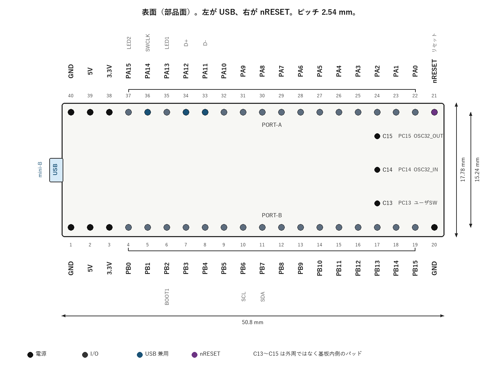
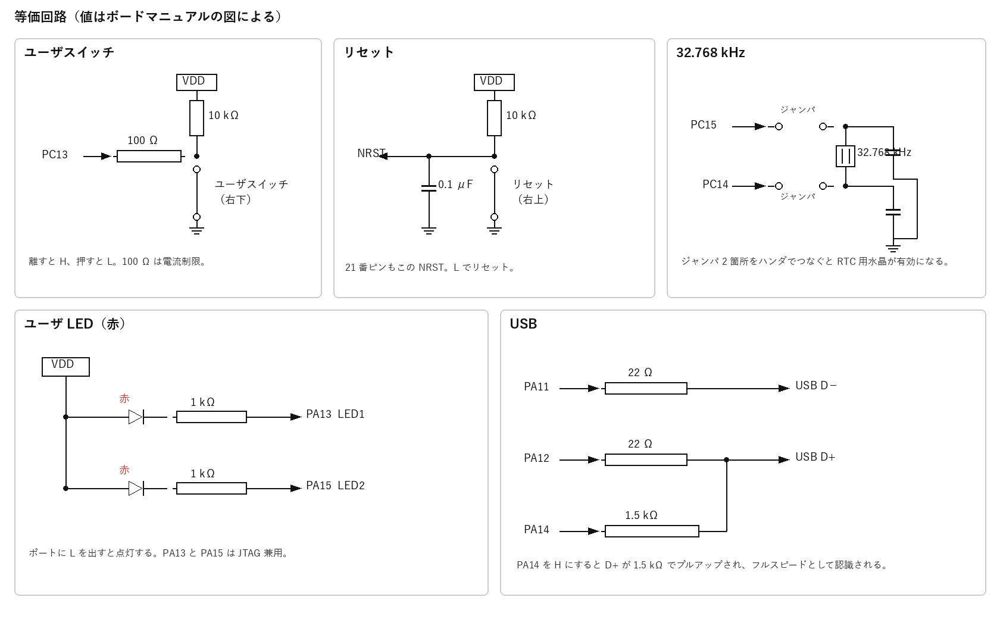

# STBee Mini Ver.2 仕様メモ

ストロベリー・リナックスの STM32 マイコンボードキット「STBee Mini」Ver.2（第3版、2013年3月5日）から、ファームウェアを書くときに参照する項目をまとめた。出典は [mini-v2.pdf](https://strawberry-linux.com/pub/mini-v2.pdf)。ピン配置と等価回路の図は、マニュアルの記載に基づいて描き直したものである。

## 概要

CPU は ST マイクロエレクトロニクスの STM32F103CBT6（Cortex-M3）。パッケージで最も大きい容量の製品で、フラッシュ 128K バイト、SRAM 20K バイトを内蔵する。USB 書き込み用の DFU ブートローダが 12K バイトを占めるため、ユーザが使えるフラッシュは最大 116K バイトである。

- クロックは 12 MHz を 6 逓倍して 72 MHz。Ver.2 では RTC 用の 32.768 kHz 水晶が載っている。
- 72 MHz 動作時の CPU 単体の消費電流は約 30 mA。
- I/O は 3.3 V（LVTTL）。名称に 5V 入力の印があるピンは、入力だけ 5 V を受けられる。出力電圧は 3.3 V である。
- 周辺は 12 ビット ADC、USART、I2C、SPI。
- 電源は USB バスパワー 5 V、または USB を使わないときの外部電源 5〜12 V。
- 基板上の入力はリセットスイッチとユーザスイッチ。出力は赤色 LED が 2 個。
- 外形は 40 ピン DIP と同じで、ブレッドボードに差せる。USB ケーブルと配線材料は付属しない。ケーブルは USB-A 対 USB ミニ B を使う。

## 外形とピンの向き

表面（部品面）を見て、左が USB ミニ B、右が nRESET である。ピン番号は DIP と同じ向きで、USB 側の PORT-B 端が 1 番、同じ端の PORT-A が 40 番、反対側の PORT-A 端が 21 番（nRESET）である。

基板外形は 50.8 mm × 17.78 mm。ピンピッチは 2.54 mm。上下のピン列の間隔は 15.24 mm（600 mil DIP と同じ）。

PORT-A は上側の PA15〜PA0（37 番〜22 番）。PORT-B は下側の PB0〜PB15（4 番〜19 番）。C13、C14、C15 は外周のピンではなく、21 番側の内側にあるパッドである。C15 が PORT-A 寄り、C13 が PORT-B 寄りで、列は 17 番ピン付近にある。

裏面には VBAT パッド、BOOT0 パッド、32.768 kHz 水晶がある。この水晶を MCU につなぐには、裏面のジャンパ 2 箇所をハンダで短絡する。

## ピン一覧

マニュアルの「他の用途」列に書かれている機能だけを載せている。STM32F103 自体の兼用機能はこれより多い。5V 入力の欄があるピンは、入力が 5 V トレラントである。

| 番号 | 名称 | 5V入力 | 他の用途 |
| --- | --- | --- | --- |
| 1 | GND | | 電源グランド |
| 2 | 5V | | 外部回路への 5 V 出力。USB を使わないときは外部電源入力 |
| 3 | 3.3V | | 外部回路への 3.3 V 出力 |
| 4 | PB0 | | ADC12_IN8 / TIM3_CH3 |
| 5 | PB1 | | ADC12_IN9 / TIM3_CH4 |
| 6 | PB2 | ○ | BOOT1 |
| 7 | PB3 | ○ | |
| 8 | PB4 | ○ | |
| 9 | PB5 | | I2C1_SMBA |
| 10 | PB6 | ○ | I2C1_SCL |
| 11 | PB7 | ○ | I2C1_SDA |
| 12 | PB8 | ○ | |
| 13 | PB9 | ○ | |
| 14 | PB10 | ○ | |
| 15 | PB11 | ○ | |
| 16 | PB12 | ○ | TIM1_BKIN |
| 17 | PB13 | ○ | TIM1_CH1N |
| 18 | PB14 | ○ | TIM1_CH2N |
| 19 | PB15 | ○ | TIM1_CH3N |
| 20 | GND | | 電源グランド |
| 21 | nRESET | | 外部リセット。L でリセット |
| 22 | PA0 | | WKUP / USART2_CTS / ADC12_IN0 / TIM2_CH1_ETR |
| 23 | PA1 | | USART2_RTS / ADC12_IN1 / TIM2_CH2 |
| 24 | PA2 | | USART2_TX / ADC12_IN2 / TIM2_CH3 |
| 25 | PA3 | | USART2_RX / ADC12_IN3 / TIM2_CH4 |
| 26 | PA4 | | SPI1_NSS / USART2_CK / ADC12_IN4 |
| 27 | PA5 | | SPI1_SCK / ADC12_IN5 |
| 28 | PA6 | | SPI1_MISO / ADC12_IN6 / TIM3_CH1 |
| 29 | PA7 | | SPI1_MOSI / ADC12_IN7 / TIM3_CH2 |
| 30 | PA8 | ○ | USART1_CK / TIM1_CH1 / MCO |
| 31 | PA9 | ○ | USART1_TX / TIM1_CH2 |
| 32 | PA10 | ○ | USART1_RX / TIM1_CH3 |
| 33 | PA11 | ○ | USART1_CTS / CAN_RX / TIM1_CH4 / USB D− |
| 34 | PA12 | ○ | USART1_RTS / CAN_TX / TIM1_ETR / USB D+ |
| 35 | PA13 | ○ | JTMS / SWDIO。ユーザ LED1 |
| 36 | PA14 | ○ | JTCK / SWCLK。USB イネーブル |
| 37 | PA15 | ○ | JTDI。ユーザ LED2 |
| 38 | 3.3V | | 3 番と同じ |
| 39 | 5V | | 2 番と同じ |
| 40 | GND | | 電源グランド |

| パッド | 名称 | 他の用途 |
| --- | --- | --- |
| C13 | PC13 | TAMPER-RTC。ユーザスイッチ |
| C14 | PC14 | OSC32_IN |
| C15 | PC15 | OSC32_OUT |

GND、3.3 V、5 V は、同じ名称のピンが基板内でそれぞれつながっている。5 V は USB の VBUS 直結ではなく、リセッタブルヒューズを通っている。

マニュアルの表で他用途が空欄の PB3、PB4、PB8〜PB11 も、マイコン側には兼用機能がある。リセットから JTAG を無効にするまでの間、PB4 はマイコン内部でプルアップされる。PB に LED を付けると、この期間だけ PB4 の LED が薄く点くことがある。

## 電源

USB 接続時、2 番ピン（5V）はヒューズを通った 5 V の出力で、外部回路へ供給できる。USB を使わないときは、このピンへ 5〜12 V の外部電源を入れる。3 番ピン（3.3V）はレギュレータ出力で、外部回路へ供給する。

基板上のリセッタブルヒューズ（F1）は、ショートなどで熱を持つと電流を遮断する。電源を切って冷えると復帰するので、交換は不要である。安全装置であり、これに頼った配線はしない。ヒューズが入っていても、状況によってはパソコンを損傷する。

バッテリバックアップを使うときだけ、裏面の VBAT パッドにバッテリをつなぐ。

## クロック

メインクロックは 12 MHz。PLL で 6 逓倍し、72 MHz で動作する。

RTC 用の 32.768 kHz は PC14（OSC32_IN）と PC15（OSC32_OUT）につながる。各ピンと水晶の間にハンダジャンパがあり、負荷容量は水晶の両端から GND へ入る。ジャンパ 2 箇所を短絡すると水晶が有効になる。

## スイッチ、LED、USB

ユーザスイッチは表面の右下にあり、PC13 につながる。VDD から 10 kΩ でプルアップしたノードを、スイッチで GND に落とす。PC13 はそのノードへ 100 Ω を介してつながる。離していると H、押すと L である。

リセットスイッチは表面の右上にあり、NRST を GND に落とす。NRST は 10 kΩ で VDD にプルアップされ、0.1 μF が GND との間に入る。21 番ピンも同じ NRST なので、21 番を GND に落とすとリセットになる。

LED1（赤）は PA13、LED2（赤）は PA15。いずれも VDD から赤色 LED と 1 kΩ を通ってポートへつながる。ポートに L を出すと点灯する。PA13 と PA15 は JTAG と兼用なので、プログラムで JTAG を無効にしないと LED を制御できない。

USB ミニ B の D− は PA11 と 22 Ω で、D+ は PA12 と 22 Ω でつながる。PA14 は 1.5 kΩ を通って、22 Ω よりコネクタ側の D+ につながる。リセット後の PA14 は内部プルダウンなので、このままではパソコンからデバイスが見えない。PA14 に H を出すと D+ がプルアップされ、フルスピードデバイスとして検出される。USB を使っている間は PA14 を H に保つ。L にすると認識が外れる。

シルクで丸印の付いた端子は USB と兼用である。USB 通信（書き込みを含む）を使うあいだ、PA11、PA12、PA14 は他の用途に使えない。PA14 を H にしても、パソコンへの応答が無い、または誤っていると、Windows は「USB デバイスが認識されません」と表示する。これはソフトウェア側の状態で、基板の故障を意味しない。

## DFU とユーザプログラム

DFU はあらかじめ書き込まれている。起動時にユーザスイッチが OFF ならユーザプログラムを実行し、ON なら DFU を実行する。

DFU へ入る手順は次のとおり。

1. ユーザスイッチを押したまま、リセットスイッチを押す。
2. ユーザスイッチを押したまま、リセットスイッチを離す。
3. ユーザスイッチを離す。

赤色 LED が点滅すれば DFU に入っている。ユーザプログラムを書いたあとでも、同じ操作で繰り返し書き換えられる。

ユーザプログラムは DFU を消さないように、先頭アドレスを DFU の後ろへずらす。割り込みベクタの位置もずれる。Cortex-M3 はベクタテーブルの先頭アドレスを移せるので、プログラム側で対応する。

## 電流

各 I/O の最大吐き出し、吸い込みは 1 ピンあたり 25 mA（-25 mA）。全ポートの合計は 150 mA まで。

PC13〜PC15 はこれと別で、合計 3 mA、負荷 30 pF まで。これらのピンで LED を駆動することは推奨されない。

## 扱うときの注意

動作しないときは、ピンヘッダのハンダ、リセッタブルヒューズの発熱、他回路を外した状態、上記の DFU 操作で赤色 LED が点滅するかを見る。

5 V 回路とつなぐときは、5 V を受けられる入力と受けられない入力、電源の立ち上がる順番に注意する。

JTAG と兼用のポートは、JTAG を無効にするまで汎用 I/O にならない。

## このリポジトリでの割り当て

このファームウェアのクロックは、ボードの 12 MHz を 6 逓倍して 72 MHz にする構成と一致する。

- LED は PA15（LED2）。L で点灯する。
- JTAG は無効にし、SWD は残す。PA13 は SWDIO、PA14 は SWCLK のままなので、LED1 は GPIO にしない。
- I2C1 は PB6 が SCL、PB7 が SDA。
- USART1 は PA9（31 番）が TX、PA10（32 番）が RX。CubeMX の `MX_USART1_UART_Init` で初期化する。測定のたびに `AT` と `AT+GMR` を送る。ESP32-C3 への給電は 39 番の 5 V と 40 番の GND で、3.3 V ピン（3 番、38 番）からは給電しない。配線は [usart.md](usart.md)。
- USB は使わない。PA14 は SWCLK であり、USB の D+ プルアップを H に保つ用途には使っていない。
